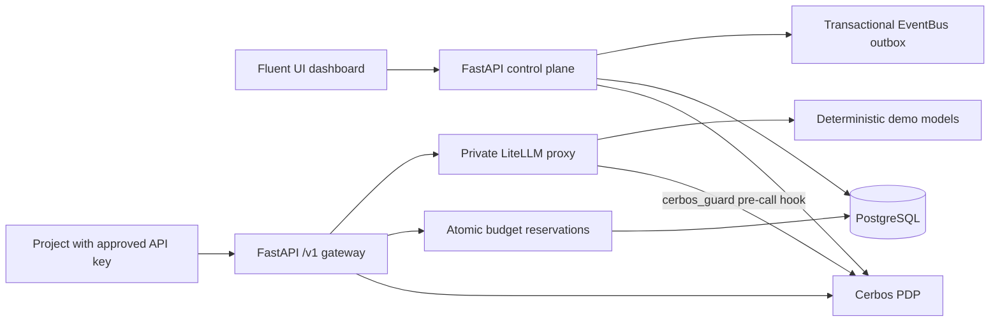

# ai-cerbos

A working local proof of concept for governing AI agents, MCP servers, agent skills, approvals and AI spending, with **Cerbos** deciding every permission and **LiteLLM** as the AI gateway.

- Every permission in the dashboard and the API is a live Cerbos decision, explained by the named rule that made it.
- **Cerbos runs inside LiteLLM** at four points: before every model call (allow, deny, or allow with obligations such as a cheaper model or fewer tokens), before every MCP tool call, when listing models, and on every response as `x-cerbos-*` headers.
- Policies are data. Change one in the browser and Cerbos validates it, runs its tests and serves it within seconds. Every decision follows, with no redeploy.

## Quick start

You need **Docker Desktop** (or any Docker engine with Compose v2) and **Python 3**. No model API key, Node or Python packages are needed.

```sh
python3 scripts/demo.py start
```

The first run builds the images and takes a few minutes. The dashboard then opens at **http://localhost:5173/playground**.

| Command | What it does |
| --- | --- |
| `python3 scripts/demo.py start` | Create local secrets, build, start, wait until healthy, open the browser |
| `python3 scripts/demo.py reset` | Restore the sample data and the shipped Cerbos policies |
| `python3 scripts/demo.py test` | Run the Cerbos policy tests, the backend tests and an end-to-end run |
| `python3 scripts/demo.py logs` | Follow the service logs |
| `python3 scripts/demo.py stop` | Stop everything; your data is kept |

Only the dashboard port is published. To use a port other than 5173, set `DEMO_PORT` in `.env`.

## The 10-minute Cerbos tour

Open **Governance › Cerbos playground**. It is one page in three parts, and every answer on it comes live from Cerbos.

1. **Who can do what, and why.** Pick a person. Fifteen plain-language capabilities in three scopes (Technology, Human Resources, Organization) show what that person can and cannot do, each with its reason; select a line for the exact rule. Each person has **three what-ifs chosen for them**, each tagged with the Cerbos concept it shows: role, team membership, scoped admin, ownership, delegation, department scope, self-approval or separation of duties. Flip one and only the decisions that depend on it change; *What Cerbos looks at* shows the attributes that changed. Nothing is saved. Good starting points:
   - **Morgan, also made a Technology cost admin:** six capabilities flip at once; a finance role removes every builder power.
   - **Alex, becomes a key approver in Agents:** still cannot approve Alex's own key request.
   - **Jordan or Casey, also covers the other department:** the same role, a wider scope.
2. **Change the rules, not the code.** Five one-click policy changes. Each is compiled and tested by Cerbos and live within about three seconds; the people board and the AI traffic board follow immediately.
3. **Cerbos inside LiteLLM.** Three API keys from three teams (Platform, Agents, People Operations) send the same nine situations as **27 real calls through LiteLLM**: standard and premium models, a long request, confidential data (also with the gateway bypassed), the model catalog, and read, write and destructive MCP tools. Each cell shows whether the call was answered, **downgraded** or **capped** by a Cerbos obligation, or refused, with the rule. Select a cell for its pipeline. Switch on *Let People Operations send confidential data to premium* and exactly Riley's confidential cell flips.

**Advanced tools** on the same page offer a decision matrix for any person, key, resource and action, a side-by-side comparison of everyone, and the raw policy YAML editor. **Reset demo** restores everything.

## Personas

| Persona | Role | Scope / demonstration |
| --- | --- | --- |
| Maya Chen | Viewer | Technology; global catalog, own submissions, own personal assets |
| Alex Rivera | Developer | Platform Engineering; team editing; delegated budget proposals; key requests |
| Morgan Ellis | Developer admin | Platform Engineering and Agents; team deletion and cost delegation |
| Jordan Lee | Cost center admin | Technology only; approve assets/budgets and set department/team caps |
| Sam Taylor | Developer + API key approver | Agents team; approve key requests across departments |
| Avery Brooks | Executive admin | Read across the organization; create operating units and assign cost admins |
| Riley Park | Developer | Human Resources / People Operations |
| Casey Reed | Cost center admin | Human Resources only |
| Quinn Davis | Finance admin | Organization cap; financial visibility without asset editing |

Walkthrough outside the playground:

1. As **Maya**, register an AI agent, MCP server or skill. It becomes pending, not immediately usable.
2. As **Jordan**, approve the Technology submission. **Casey** cannot see or decide it.
3. As **Morgan**, propose an agent budget change or grant or revoke a team member's right to propose changes. **Jordan** must approve a proposal before the active cap changes.
4. As **Alex**, request an API key for an approved agent. An initial request is ready to review for Atlas.
5. As **Sam**, approve the key and optionally reduce the requested budget, RPM or TPM. You cannot increase the request or approve your own.
6. As the requesting owner, open **API keys**, reveal the key once and use **Test** to send a real request through the governed LiteLLM path.
7. Open an asset to see its live Cerbos decisions, each with the rule that decided it.

Seeded registry entries, historical spend, names and approvals are demonstration data. New actions and their audit records persist until you reset the demo.

## How Cerbos is used

- **Every decision is delegated.** [`backend/app/policy.py`](backend/app/policy.py) sends principals and resources to Cerbos `/api/check/resources` in batches. There is no fallback allow path: if Cerbos is unavailable, access is denied.
- **Every rule is named and explains itself.** Each rule in [`cerbos/policies`](cerbos/policies) has a `name` and an `output` sentence. The dashboard shows which rule decided, or that nothing matched and Cerbos denied by default.
- **Cerbos inside LiteLLM.** [`infra/cerbos_guard.py`](infra/cerbos_guard.py) plugs into four LiteLLM hooks; see the next section.
- **Live policies.** Cerbos watches a policy volume. The API validates each edit with the bundled Cerbos CLI, writes it atomically, and confirms Cerbos serves it before reporting success; if not, it rolls back.
- **Tested policies.** `cerbos/policies/*_test.yaml` with fixtures in `cerbos/policies/testdata/` pin the documented behaviour. `demo.py test` and CI run them, and every policy edit in the browser runs them too.

## Cerbos and LiteLLM

The principal inside LiteLLM is the API key itself (role `api_key`). Its owner, team, department and agent are written into the key's metadata when the governed API issues it, so LiteLLM never needs the user database. Calls without that metadata, including master-key calls, are denied, and any Cerbos failure denies the call.

| LiteLLM hook | Cerbos check | What it shows |
| --- | --- | --- |
| `async_pre_call_hook` (model calls) | `model:invoke` with tier, `max_tokens` and data classification ([`model.yaml`](cerbos/policies/model.yaml)) | Allow, deny, or allow with **obligations** that LiteLLM applies: downgrade premium to standard for other teams, cap tokens at 512, never send confidential data to the standard model |
| `async_pre_call_hook` (MCP tool calls) | `mcp_tool:call` with the tool's risk from its MCP annotations and the server's owning team ([`mcp_tool.yaml`](cerbos/policies/mcp_tool.yaml)) | Read tools for every key, write tools for the owning team, destructive tools never through keys |
| `async_filter_listed_models` | `model:list` | `GET /v1/models` lists only what the key may use |
| `async_post_call_response_headers_hook` | the decision above | `x-cerbos-decision`, `x-cerbos-rule`, `x-cerbos-reason`, `x-cerbos-obligations` on every response |

**How an obligation is enforced.** Cerbos is the decision point and never touches traffic. For a Platform key asking for the premium model, rule `premium-downgraded-for-other-teams` returns ALLOW with the output `{"obligations": {"model": "governed-demo"}}`. LiteLLM's pre-call hook, the enforcement point, rewrites the request's model before LiteLLM routes it, so the call goes to the standard deployment. The response carries `x-cerbos-obligations`, and the gateway prices the call by the model that actually answered (LiteLLM's `x-litellm-model-group` header). Token caps work the same way, with `{"max_tokens": 512}`.

**Separation of duties.** Cerbos evaluates each role on its own, so a deny rule limited to admin roles would not stop an admin who also holds a builder role. The admin deny rules therefore apply to every role and check whether the principal holds an admin role; `separation_of_duties_test.yaml` proves it.

The governed gateway also asks Cerbos (`asset:use`) and reserves budget before forwarding. When the Cerbos guard rejects a call, no provider was contacted, so the reservation is released; a downgraded call is billed at the price of the model that actually answered. The demo MCP server is [`backend/app/mcp_demo.py`](backend/app/mcp_demo.py), registered in [`infra/litellm.yaml`](infra/litellm.yaml) and reachable only through LiteLLM.

## Permission decisions

Roles are scoped capabilities, not a linear administrator hierarchy. The design deliberately separates builders, financial approvers, API-key reviewers, and executives.

| Action | Viewer | Developer | Developer admin | Cost center admin | Executive admin |
| --- | --- | --- | --- | --- | --- |
| View active global catalog | Yes | Yes | Yes | Assigned departments only | All assets, including non-global |
| Register assets | In own department/team | In own department/team | In own department/team | No | No |
| Edit assets | Own | Own or member team | Own or member team | No | No |
| Delete/archive | Own **personal** assets | Own **personal** assets | Assigned admin teams, or own personal | No | No |
| Propose agent caps | Only when delegated | Only when delegated | Assigned admin teams | No; reviews requests | No |
| Delegate/revoke cost editing | No | No | Assigned admin teams | No | No |
| Approve asset/cap requests | No | No | No | Assigned departments, never own request | No |
| Set department/team caps | No | No | No | Assigned departments | No |
| Request API keys | No | Approved agents owned personally or assigned to own teams | Same | No | No |
| Create operating units / assign cost admins | No | No | No | No | Yes |

Additional roles:

- **`api_key_approver`** requires current membership in the Agents team. It allows API-key approval across departments, independent of budget-change approval. The seed assigns it to Sam, a developer. Merely joining a team does not silently grant approval authority.
- **`finance_admin`** owns the organization-wide spending cap. Department administrators cannot change a global cap and thereby affect other departments.

Additional rules:

- Ownership never permits a developer to delete a shared team asset. “Delete” archives the asset, revokes its keys at the public gateway, cancels pending requests, and keeps the audit trail.
- Asset edits require reapproval and suspend use until approval. Version checks reject stale edits; pending asset requests prevent overlapping edits.
- Approval checks include request kind, requester, status, department, and reviewer scope. A request is decided once. The requester's current permissions are checked again at approval time, so revoking delegated access also blocks a pending proposal.
- Cost administrators use dedicated accounts, and the policies enforce separation of duties even if a person holds an admin role and a builder role at once.
- Global visibility grants discovery, not spending permission, team mutation, or financial visibility.
- Private assets have personal ownership, not team ownership; the form clears team assignment when private visibility is selected.
- Department and team caps are direct administrator actions with required reasons and audit events. Agent-cap changes always use the independent approval workflow.
- All money is stored as integer millionths of USD. A zero cap blocks use. Negative/non-finite values and unsupported fields are rejected.

Cerbos policies are in [`cerbos/policies`](cerbos/policies). [`backend/app/policy.py`](backend/app/policy.py) calls `/api/check/resources` in batches. There is no fallback allow path when Cerbos is unavailable.

## Strict budgets and LiteLLM



The issued credential is a real LiteLLM virtual key. It may call `governed-demo` and `governed-premium` at LiteLLM, where Cerbos decides per request which one it may actually use. It has a positive key budget, expiry, RPM, and TPM. The application stores its SHA-256 lookup hash and an encrypted copy needed for one-time owner retrieval and the dashboard's test action. List, audit, and approval responses never return the secret.

Key display names may repeat. LiteLLM receives a unique internal alias for each issuance, with the display name stored in metadata, so two requests called “Robin” do not conflict. Failed issuance leaves the approval pending; rejected settings, credentials, rate limits, and connection failures have distinct errors. Upstream response bodies and credentials are not exposed in those errors or logs.

All project traffic must use `http://localhost:5173/v1`. The underlying LiteLLM proxy is private. The public FastAPI gateway checks the key, the current owner, the approved asset, model access, expiry, and rate limits before reserving money. The same credential cannot bypass department/team/agent limits because no direct LiteLLM port is published.

For each request:

1. Validate a bounded, non-streaming request for a supported model and require an `Idempotency-Key`.
2. Calculate a conservative maximum cost from byte-based input metering and the requested output limit.
3. Lock the organization budget first, then required rows in a consistent order. This deliberately serializes admission decisions in the POC.
4. Check **organization → department → optional team → agent → key**. Reject before the provider call if any cap would be exceeded, including outstanding reservations.
5. Commit the reservation before forwarding to LiteLLM. LiteLLM independently applies the virtual key's own limits, and its Cerbos guard decides model access.
6. On a valid response, replace reservations with actual cost atomically across every applicable budget.
7. If LiteLLM's Cerbos guard rejects the call, no provider was contacted: release the reservation and record the rule. Only a 403/503 carrying the guard's own marker counts.
8. On any other uncertain provider outcome, retain the reservation and flag reconciliation. Never assume a timeout means no charge, and never retry automatically.

Repeated identical requests with the same idempotency key return the stored response without a second provider call or charge. Reuse with different content is rejected. Revoked or expired keys cannot retrieve responses either.

Budgets are **cumulative, non-renewing POC caps**. Child caps do not preallocate portions of their parent; the parent enforces aggregate spend. Child caps may sum to more than the parent, but cannot spend beyond it. Lowering a cap below spent plus reserved funds is rejected. Parent reductions immediately constrain new spending even if a child's previously approved cap is larger.

The models are deliberately deterministic, with explicit input/output pricing (premium costs five times standard) and no paid provider calls. MCP URLs and skill URLs are registry metadata; they are not executed or fetched by this POC. Connecting real models requires an independently verified pricing/tokenization contract, model maximums, and explicit handling of tools, multimodal input, hidden reasoning, provider retries, and streaming. This POC does **not** claim arbitrary real-provider invoices can be strictly bounded by a generic estimate.

Example project request (replace the environment variable with a securely stored issued key):

```sh
curl http://localhost:5173/v1/chat/completions \
  -H "Authorization: Bearer $AI_CERBOS_API_KEY" \
  -H "Idempotency-Key: project-request-0001" \
  -H "Content-Type: application/json" \
  -d '{"model":"governed-demo","messages":[{"role":"user","content":"Hello"}],"max_tokens":128}'
```

Virtual keys and budgets follow the documented [LiteLLM virtual-key API](https://docs.litellm.ai/docs/proxy/virtual_keys) and [budget controls](https://docs.litellm.ai/docs/proxy/users). The additional PostgreSQL admission ledger enforces this application's hierarchy and deterministic model cost contract. Policy integration uses the [Cerbos CheckResources API](https://docs.cerbos.dev/cerbos/latest/api/index.html).

## EventBus and persistence

Every successful business change and its event are written in one database transaction. An EventBus worker polls the persistent outbox with `FOR UPDATE SKIP LOCKED`, invokes subscribers, and acknowledges delivery. Delivery is at least once; new subscribers must be idempotent. The POC subscriber logs delivery. Audit rows remain queryable independently of dispatch. No audit-delete endpoint exists.

Alembic's initial migration uses a frozen SQL schema snapshot, not a dynamic import of future application models. Application and LiteLLM databases are separate. Secrets are encrypted with a locally generated Fernet key; the master LiteLLM key stays server-side.

## Tests

```sh
python3 scripts/demo.py test
```

This runs, entirely in containers:

1. **Cerbos policy tests:** `cerbos compile` over the shipped policies and all `*_test.yaml` suites.
2. **Backend tests:** pytest against a disposable PostgreSQL database and a separate Cerbos loaded with the shipped policies, so edits made in the playground never change test results. They cover scoped decisions, every guided scenario, policy editing and reset, direct API denials, CSRF headers and origins, Cerbos outages, one-time secret retrieval, expiry, rate limits, each level of the spending hierarchy, idempotency, concurrency, uncertain provider outcomes and Cerbos-guard rejections.
3. **End-to-end run:** registration, scoped approval, real LiteLLM keys, one-time reveal, completion, idempotent replay, hard budget rejection and revocation; then the full 27-call AI traffic board through LiteLLM must match the expected outcomes, including obligations, and a live policy change must flip exactly the expected cell.

### Developing on the host

`compose.dev.yaml` publishes Postgres (5432), Cerbos (3592) and the API (18000) on localhost:

```sh
docker compose -f compose.yaml -f compose.dev.yaml up -d --build --wait
cd backend && uv sync --frozen && cd ..
backend/.venv/bin/python scripts/test.py
```

For frontend development, stop the Compose `frontend` service and run `npm run dev` in `frontend/`. Vite proxies `/api`, `/v1` and `/docs` to `localhost:18000`.

## Continuous integration

[`.github/workflows/ci.yml`](.github/workflows/ci.yml) runs on pushes to `main`, pull requests and manual dispatch:

- **Backend lint:** `uvx ruff check backend` and `uvx ruff format --check backend`.
- **Frontend:** `npm ci`, `npx biome check .`, `npx tsc -b --noEmit` and `npm run build`.
- **Cerbos policies:** `cerbos compile`, which validates every policy and runs the test suites.
- **Integration:** `python3 scripts/demo.py test`, the same command reviewers run locally.

Actions are pinned to commit SHAs.

## POC boundaries

- **Demo sign-in is intentionally an impersonation selector.** It is enabled only by `DEMO_MODE=true`. This is a local demonstration, not production authentication. Disabling it removes demo login and seeding; connecting an OIDC provider and mapping trusted identity claims remains deployment work. Rotate the session secret when disabling demo mode to invalidate existing demo cookies.
- Use HTTPS, secure cookies, an identity provider, separate database roles, managed secrets, network policy, and durable external audit retention before a shared deployment.
- The outbox has a single in-process logging subscriber; it is not an external Kafka/RabbitMQ deployment. Delivery state is durable, and multiple workers can safely claim different rows.
- Uncertain or interrupted model calls keep their funds reserved. Add an operational reconciliation process based on verified provider records before production use. The POC has no automatic release or reset that could permit overspending.
- Revocation and archival stop new gateway requests immediately and then delete the virtual key at LiteLLM (best effort). Already-admitted requests can finish and settle their reserved amounts. LiteLLM has no public port, so local revocation remains effective if its management API is down.
- The Cerbos playground and its policy editor exist only in demo mode. They require a signed-in session but are deliberately not authorized through Cerbos, so a policy edit can never lock out the editor or the reset. Edits apply to everyone using the demo.
- MCP invocation, skill execution, real model integration, team/user provisioning, SSO, notifications, monthly budget resets, and historical analytics beyond seeded/imported events are outside this POC.
- The all-resource dashboard read and global admission lock prioritize clarity and correctness. Scale with Cerbos query planning, scoped pagination, finer-grained locking, and a dedicated worker after profiling.

## Source map

```text
frontend/src/            dashboard, permission-aware pages and forms
frontend/src/playground/ Cerbos playground: story page (people, rules, LiteLLM) and advanced tools
backend/app/             API, models, authorization, budgets, EventBus, playground API, demo MCP server
backend/migrations/      Alembic migrations
backend/tests/           policy, scenario, API and concurrency tests
cerbos/policies/         executable authorization policies and their unit tests
infra/                   LiteLLM configuration and its Cerbos guard (four hooks), Postgres
scripts/demo.py          one command to start, reset, test and stop
compose.yaml             complete local deployment; compose.dev.yaml publishes internal ports
```

## Troubleshooting

- **Docker is not running.** Start Docker Desktop, then rerun `python3 scripts/demo.py start`.
- **Port 5173 is in use.** `start` checks this before building. Stop whatever uses the port, or set `DEMO_PORT=5180` (or any free port) in `.env` and start again.
- **Using a Docker context other than the current one.** Set it for the command, for example `DOCKER_CONTEXT=<name> python3 scripts/demo.py start`.
- **Starting completely fresh.** `docker compose down -v` deletes the demo database and the live policies. `python3 scripts/demo.py reset` is usually enough.
